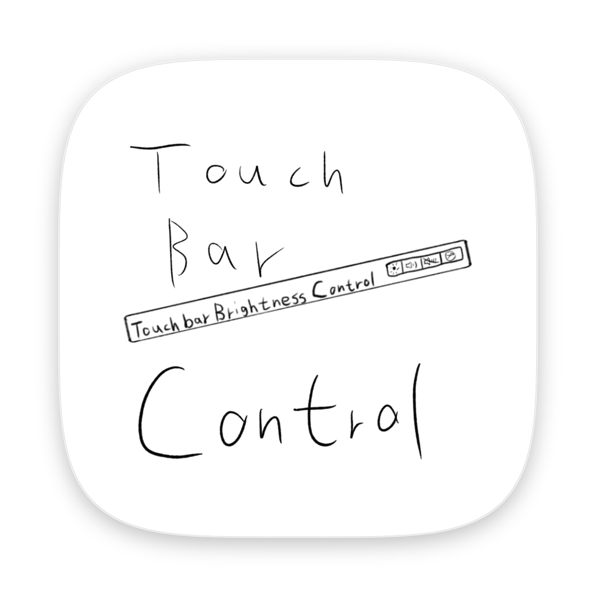
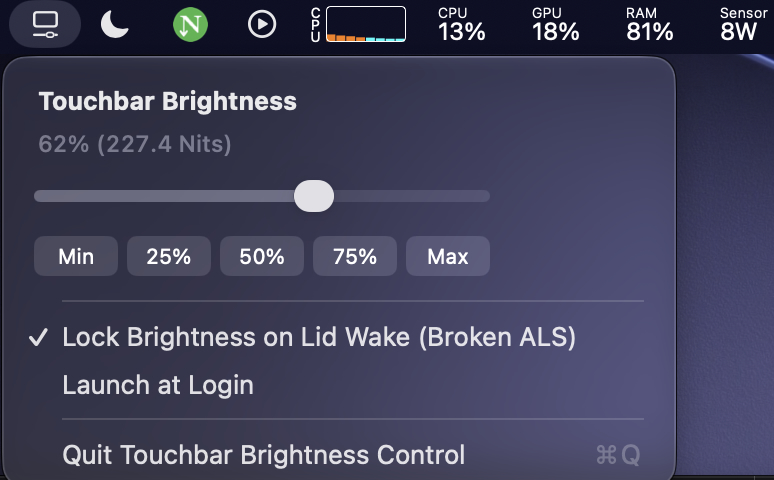

# Touchbar Brightness Control

<p align="center">
  
</p>

A lightweight, native macOS menu bar utility that adds a **real-time Touch Bar brightness slider (`11.9 Nits` – `357.1 Nits`)** and fixes the bug where the Touch Bar gets stuck at minimum brightness after lid close/wake on MacBooks with a broken Ambient Light Sensor (ALS).

---

## 1. Features

* **Real-Time Brightness Slider**: Smoothly adjust Touch Bar brightness from `0%` (`11.9 Nits`) to `100%` (`357.1 Nits`) directly from the macOS menu bar, with live hardware Nits readout.
* **Quick Presets**: One-click buttons for `Min` (`11.9 Nits`), `25%` (`98.2 Nits`), `50%` (`184.5 Nits`, factory default), `75%` (`270.8 Nits`), and `Max` (`357.1 Nits`).
* **Broken ALS Wake Lock**: Automatically prevents macOS from dropping Touch Bar brightness to minimum when closing and reopening the lid.
* **Zero Background Overhead (`0 Hz` Polling)**: 100% event-driven architecture (`0.0%` idle CPU usage and `0` Idle Wakeups in Activity Monitor).
* **(Failed)Launch at Login**: Built-in toggle to start automatically on login. (Not working at the moment, i have no idea why, but i'll try) --lfx

  <p align="center">
  
</p>


---

## 2. Installation

### Option A: Download Prebuilt App
1. Download **`Touchbar-Brightness-Control-macOS-Universal.zip`** from this repository (or Releases) and extract **`Touchbar Brightness Control.app`**.
2. Drag **`Touchbar Brightness Control.app`** into your **`Applications`** folder and double-click to open it.
3. Go to **System Settings** -> **Privacy & Security**, scroll down to the **Security** section, and click **Open Anyway**.

### Option B: Build from Source
Requires Xcode Command Line Tools (`xcode-select --install`). No external dependencies:
```bash
git clone https://github.com/LangerFox/Touchbar-Brightness-Control.git
cd Touchbar-Brightness-Control
make
open "Touchbar Brightness Control.app"
```

---

## 3. Supported Devices

Compiled as a **Universal Binary (`arm64` + `x86_64`)** for macOS 12.0+:

* **Apple Silicon (13-inch MacBook Pro with Touch Bar)**:
  * MacBook Pro (13-inch, M1, 2020) — `MacBookPro17,1` (`A2338`)
  * MacBook Pro (13-inch, M2, 2022) — `Mac14,7` (`A2338`)
* **Intel (13-inch & 15/16-inch MacBook Pro with Touch Bar, 2016–2020)**

---

## 4. Why Does This Happen After Updating macOS?

If you replaced your MacBook Pro screen with a third-party display assembly—or if the top camera / Ambient Light Sensor (ALS) flex cable failed—you may notice a frustrating issue after updating to recent macOS versions (such as macOS 26.5+):

1. **Right after a reboot**, the Touch Bar lights up normally at its factory default brightness (`50%` / `184.5 Nits`).
2. **As soon as you close the lid and open it again (or wake from display sleep)**, the Touch Bar drops to its lowest possible brightness (`11.9 Nits`) and stays stuck there until you reboot.

Because macOS System Settings does not provide a manual Touch Bar brightness slider, there is no built-in way to bring the brightness back up once macOS dims it on wake.

---

## 5. Technical Deep Dive

Inside `/System/Library/PrivateFrameworks/CoreBrightness.framework`, macOS manages the main Retina display and the Touch Bar OLED (`AppleSummitLCD` / `CBDisplayModuleDFR`) as two separate display containers inside `BLControl`:

* On the **main Retina display**, when no ALS (`AppleSPUALSDriver`) is detected, macOS sets `CBAutoBrightnessAvailable = 0` and `CBAutoBrightnessEnabled = 0`, disabling auto-brightness cleanly.
* On the **Touch Bar (`CBDisplayModuleDFR`)**, even when `CBAutoBrightnessModuleDFR` reports `BLControlAlsSupported = 0`, `CBDisplayModuleDFR` still defaults to **`DisplayBrightnessAuto = 1`**.
* On a fresh boot, the DFR display controller (`AppleMobileADBE0`) initializes the OLED panel at its hardware midpoint (`DisplayPanelLuminanceMid = 184.5 Nits`).
* However, the moment the display wakes from sleep (`displayLogicalStatePropertyHandler:`), `CBAutoBrightnessModuleDFR` evaluates the ambient light sensor reading. Because the ALS is disconnected or dead, it reads **`0 Lux` (pitch black)** and forces the Touch Bar down to index `0` of `NitsToUserBrightnessTable`:
  ```text
  DisplayBrightness = {
      Brightness = 0;
      Nits = "11.89999";
      NitsPhysical = "11.89999";
  };
  ```

### How `Touchbar Brightness Control` Solves It

`Touchbar Brightness Control` communicates directly with `CoreBrightness.framework`'s private `BrightnessSystemClient` API:
```objc
[client setProperty:@NO forKey:@"DisplayBrightnessAuto"];
[client setProperty:@(targetBrightness) forKey:@"DisplayBrightness"];
```
To achieve `0.0%` idle CPU usage without polling timers, the app sleeps in kernel `mach_msg2_trap` and only wakes on:
1. `CoreBrightness` XPC property notifications (`registerNotificationBlock:forProperties:`)
2. `NSWorkspaceDidWakeNotification` & `NSWorkspaceScreensDidWakeNotification`
3. `CGDisplayRegisterReconfigurationCallback`

---
README by Gemini 4 Argon

Icon by LangerFox(lfx)

## License

MIT License
